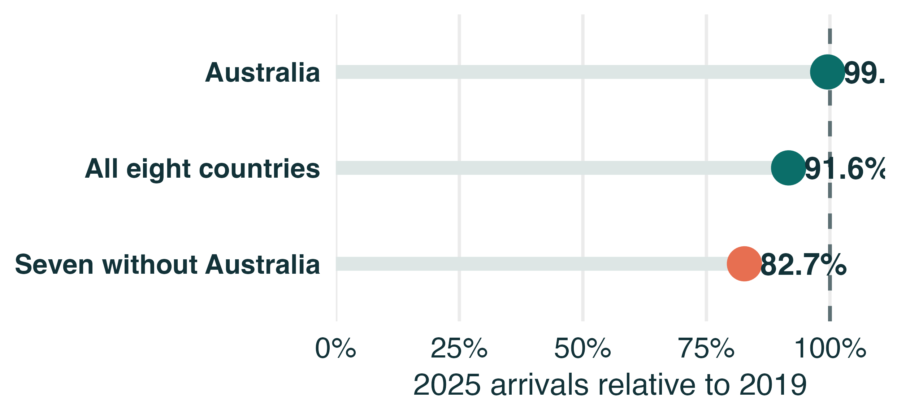
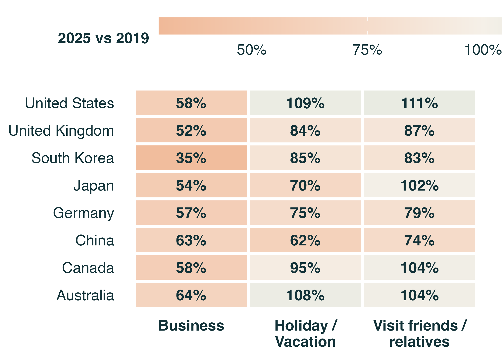
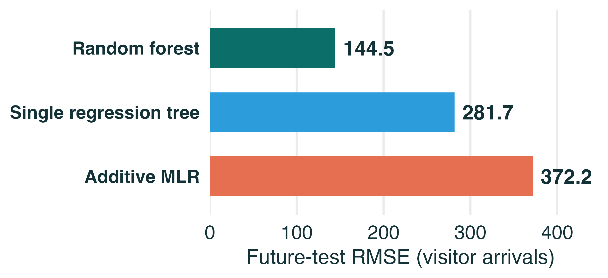
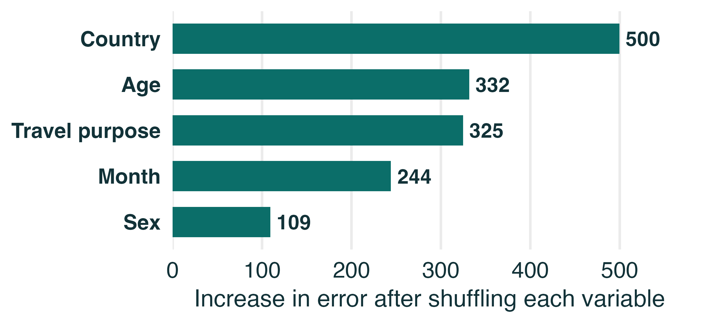

# Beyond the Headline: Modelling New Zealand Visitor Arrivals

> Did New Zealand recover the same visitor market, or did only the total recover?

This R-based data-mining project investigates monthly visitor-arrival estimates
for New Zealand across eight countries, three travel purposes, sixteen age
groups and two sex categories. The analysis moves beyond the headline total to
test whether the composition of the market recovered uniformly and whether
later arrivals can be predicted without using future information during model
development.

## Key findings

- The eight-country total in 2025 reached **91.6%** of its 2019 level, while
  the seven countries excluding Australia reached **82.7%**.
- Recovery differed sharply by country and travel purpose. Business travel
  reached **62.3%** of its 2019 level, and none of the eight Business segments
  exceeded their 2019 total.
- A future-tested random forest substantially outperformed the additive MLR:
  **RMSE 144.5 versus 372.2**, with **R² 0.934** and no negative predictions.

## Data

The working table contains **96,000 Month × Country × Purpose × Age × Sex
cells** from January 2016 to May 2026. Each response is a published estimate of
passenger movements, not a unique traveller record. The source is a transformed
extract of Stats NZ Infoshare International Travel data.

The raw workbook is not included because this repository does not assume
redistribution permission. See [`data/README.md`](data/README.md) for the source,
schema and local setup.

## Investigation journey

1. **Audit and cleaning** - checked the grain, missingness, duplicates,
   categories, zero-valued cells and monthly coverage.
2. **Exploratory analysis** - examined country, purpose, demographic and
   seasonal patterns, including the border-restriction discontinuity.
3. **First MLR** - documented weak future performance and invalid negative
   predictions rather than hiding the unsuccessful attempt.
4. **Recovery reframing** - compared 2025 with 2019 and tested whether country
   and purpose should be interpreted together.
5. **Binary classification** - showed why accuracy alone was misleading when
   recovered market-months were uncommon.
6. **Tree-based extension** - compared a regression tree, pruning, bagging and
   random forest with validation-based tuning and an untouched future test.

## Final model comparison

The final tree-based model excluded March 2020 through February 2022 because
the border-closure period created an exceptional structural break. Model
development used observations through April 2025. May 2025 through May 2026
formed the future test period.

| Model | Future-test RMSE | MAE | R² | Negative predictions |
|---|---:|---:|---:|---:|
| Random forest (100 trees, mtry = 4) | **144.5** | **55.0** | **0.934** | **0** |
| Additive MLR | 372.2 | 211.3 | 0.561 | 2,519 |

Country had the largest permutation importance, followed by Age, Travel
Purpose, Month and Sex. These values measure predictive dependence inside the
model. They are not arrival counts or causal effects.

## Methods and tools

- R and RStudio
- `tidyverse`, `readxl`, `ggplot2`, `tree`, and `randomForest`
- Data-quality auditing and feature engineering
- Multiple linear regression with polynomial and interaction terms
- Binary logistic regression and confusion-matrix metrics
- Regression trees, cross-validated pruning, bagging and random forests
- Chronological train, validation and test design
- MSE, RMSE, MAE, R², sensitivity, specificity and balanced accuracy
- Reproducible figures and automated result checks

## Reproducing the analysis

1. Follow the local data setup in [`data/README.md`](data/README.md).
2. Open `RemoteDataMiners.Rproj` in RStudio.
3. Run the numbered scripts in `R/` from `01_data_audit.R` through
   `13_poster_figures.R`.

The scripts deliberately separate raw data, processed data, analysis, modelling,
validation and presentation figures.

## Limitations

- The dataset covers eight selected countries, not the entire visitor market.
- Detailed cells are sample-derived published estimates.
- The data supports description and prediction but cannot establish why the
  patterns occurred. Air capacity, prices, exchange rates and policy settings
  are not included.
- COVID-era border restrictions create a structural break rather than ordinary
  seasonality.
- Future-test performance applies to this dataset, target and time window.

Read [`docs/limitations.md`](docs/limitations.md) for further detail.

## Project and contribution

This work began as the **Remote Data Miners** group project for STAT462 Data
Mining at the University of Canterbury. My contribution included shaping the
investigation questions, integrating the reproducible R workflow, validating
model outputs, developing comparison visuals, and coordinating the final data
story across the presentation and poster. The public repository presents the
work as a group project and does not rank individual contributions.

## Source

- [Stats NZ Infoshare](https://infoshare.stats.govt.nz/Default.aspx)
- [Stats NZ international-travel metadata](https://datainfoplus.stats.govt.nz/Item/nz.govt.stats/f705ca38-ea6e-453f-b1d9-a95dc0fcaf59)
